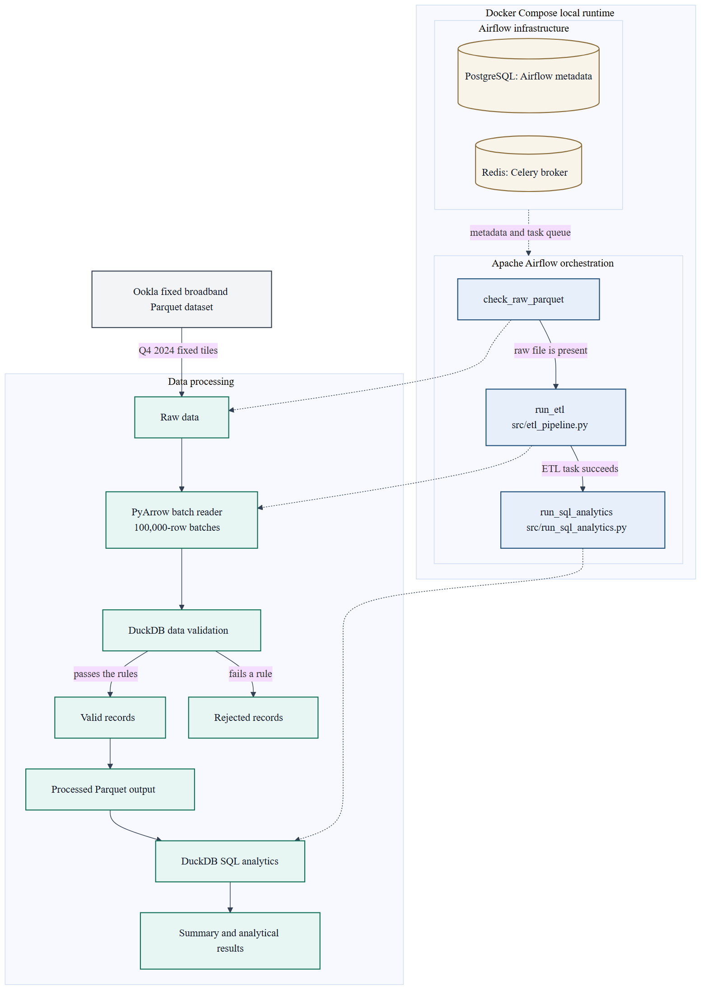

# Network Performance Data Engineering Pipeline

A local data engineering pipeline for Ookla's public fixed-broadband performance data. It lands a quarterly Parquet file, checks each geographic tile in batches, writes valid and rejected outputs, and runs read-only SQL over the processed file. Apache Airflow can run those steps in order inside Docker. The same Python scripts also run directly on Windows.

The dataset is tile-level. Each row is one geographic tile with aggregated performance metrics, not one speed test and not one person.

Repository: [github.com/PavanReddy4656/ookla-data-engineering](https://github.com/PavanReddy4656/ookla-data-engineering)

## Contents

1. [Project objectives](#project-objectives)
2. [Architecture](#architecture)
3. [Technology stack](#technology-stack)
4. [Dataset](#dataset)
5. [ETL pipeline](#etl-pipeline)
6. [Data quality](#data-quality)
7. [SQL analytics](#sql-analytics)
8. [Airflow orchestration](#airflow-orchestration)
9. [Project structure](#project-structure)
10. [Setup and execution](#setup-and-execution)
11. [Testing](#testing)
12. [Performance and engineering decisions](#performance-and-engineering-decisions)
13. [Limitations and future improvements](#limitations-and-future-improvements)

## Project objectives

- Build a reproducible ETL pipeline that can be run again without changing the raw file.
- Process a large Parquet file without loading every row into memory at once.
- Validate data quality and keep legitimate nulls in the directional latency columns.
- Run SQL analytics on the processed tile data.
- Orchestrate the file check, ETL, and SQL analytics with Airflow.

## Architecture



The editable diagram is [docs/architecture.mmd](docs/architecture.mmd).

Data moves from left to right in the processing path, top to bottom in this rendering:

1. The public Ookla fixed-broadband Parquet file is the source. This project uses the Q4 2024 file.
2. **Raw data** is that file stored at `data/raw/2024-10-01_performance_fixed_tiles.parquet`. The pipeline only reads it.
3. **PyArrow** reads the file in batches of 100,000 rows.
4. **DuckDB** applies the validation rule to each batch.
5. Rows that pass are **valid records**. Rows that fail are **rejected records**.
6. Valid rows are published as the **processed Parquet** file. Rejected rows are published only when at least one row fails.
7. **DuckDB SQL analytics** reads the processed file through the queries in `sql/`.
8. The scripts print a **summary and analytical results**. Those results are not stored in PostgreSQL or Redis.

Airflow is the orchestration layer, drawn separately from the data path. Docker Compose runs that local Airflow stack. The three tasks are `check_raw_parquet`, then `run_etl`, then `run_sql_analytics`. Dotted lines show which task starts which part of the data path. PostgreSQL stores Airflow metadata. Redis is the Celery broker that queues work for the worker. Neither database holds the tile table or the query results.

The same processing scripts can run from the Windows virtual environment without Docker. Airflow is an additional way to order those scripts and to surface a failed step.

## Technology stack

| Technology | How this repository uses it |
| --- | --- |
| Python | Pipeline, analytics, profiling, and test code in `src/` and `tests/`. |
| PyArrow | Reads the raw Parquet file in batches and writes the valid and rejected Parquet files. Also used by `src/profile_dataset.py` to read the file footer. |
| DuckDB | Applies the validation SQL to each batch, counts rows, and runs the analytics queries directly on Parquet. |
| SQL | Read-only queries in `sql/`. The Python scripts open those files and run them. They do not create a permanent database file. |
| Apache Airflow | DAG `ookla_fixed_broadband` in `dags/ookla_fixed_broadband.py`. The image is `apache/airflow:3.3.2-python3.12`. |
| Docker | `Dockerfile` adds DuckDB 1.5.6 and PyArrow 25.0.1 to that Airflow image. |
| Docker Compose | `docker-compose.yaml` is the Airflow 3.3.2 local Compose file, with this project's mounts and image build added. |
| PostgreSQL | Airflow's metadata database in the Compose stack. It is not the analytical store. |
| Redis | Celery broker between the Airflow scheduler and worker. It does not store query results. |
| pytest | Tests in `tests/` use small temporary Parquet files. They do not read or write the real Ookla files. |

`requirements.txt` also lists pandas. None of the current scripts import pandas. Parquet I/O goes through PyArrow, and the SQL goes through DuckDB. Airflow is not installed in the Windows virtual environment.

## Dataset

The file is Ookla Open Data for fixed broadband performance, quarter 4 of 2024:

`https://ookla-open-data.s3.amazonaws.com/parquet/performance/type=fixed/year=2024/quarter=4/2024-10-01_performance_fixed_tiles.parquet`

Place it at:

`data/raw/2024-10-01_performance_fixed_tiles.parquet`

Git ignores everything in `data/raw/` and `data/processed/` except the `.gitkeep` files. Do not commit the Parquet files.

Each row is one geographic tile. `tests` is the test count stored on that tile. `devices` is the device count stored on that tile. Those fields are not a list of individual speed tests, and they are not a count of unique people or unique devices across the whole file.

| Column | Type | Meaning |
| --- | --- | --- |
| `quadkey` | string | Geographic tile identifier. Required, and not blank. |
| `tile` | string | Tile geometry stored as text. In this file the values are polygon text. Required, and not blank. |
| `tile_x` | double | Tile coordinate. Must be from -180 through 180. |
| `tile_y` | double | Tile coordinate. Must be from -90 through 90. |
| `avg_d_kbps` | 64-bit integer | Average download speed for the tile, in kilobits per second. |
| `avg_u_kbps` | 64-bit integer | Average upload speed for the tile, in kilobits per second. |
| `avg_lat_ms` | 64-bit integer | Average latency for the tile, in milliseconds. |
| `avg_lat_down_ms` | 32-bit integer | Average downstream latency, in milliseconds. Null is allowed. |
| `avg_lat_up_ms` | 32-bit integer | Average upstream latency, in milliseconds. Null is allowed. |
| `tests` | 64-bit integer | Number of tests recorded for the tile. Must be greater than zero. |
| `devices` | 64-bit integer | Number of devices recorded for the tile. Must be greater than zero. |

Analytics display speed in megabits per second with `1 Mbps = 1,000 kbps`. The Parquet file itself stays in kilobits per second. Latency stays in milliseconds.

## ETL pipeline

`src/etl_pipeline.py` is the ETL script. It resolves paths from the script file, so the working directory does not change the input or output location.

| Path | Role |
| --- | --- |
| `data/raw/2024-10-01_performance_fixed_tiles.parquet` | Raw input. Never overwritten. |
| `data/processed/2024-10-01_performance_fixed_tiles.parquet` | Valid rows. |
| `data/processed/rejected_records.parquet` | Rejected rows, and only when the rejected count is greater than zero. |

What one run does:

1. Confirm the raw file exists and record its size and modified time.
2. Count input, valid, rejected, and null latency rows with one DuckDB aggregate. Stop if valid plus rejected does not equal the input count. Nothing is published in that case.
3. Read the raw file with PyArrow in batches of `PARQUET_BATCH_ROWS` (100,000).
4. Register each batch in DuckDB and apply `VALID_RECORD_CONDITION`. The result is cast back to the source Parquet schema so column names, types, and nulls stay as they were.
5. Append valid rows to `*.partial` and, when a batch has rejected rows, append those to their own `*.partial`.
6. Close the partial files, count them, and compare the counts with step 2.
7. Publish with `os.replace` only after the counts match. If there are zero rejected rows, delete a stale `rejected_records.parquet` only after the new valid file is in place.
8. Log a data-quality summary. On failure, log the error and exit with status 1. The success line is not logged after a failure.

DuckDB is configured in `configure_duckdb()` before the heavy work:

- `memory_limit` is `512MB`. DuckDB reports that decimal limit as `488.2 MiB`.
- `threads` is `1`.
- `preserve_insertion_order` is `false`.
- Spill files go in `data/processed/.duckdb-temp` and that directory is removed after the connection closes.

Partial files use the suffix `.partial`. A run deletes any partial left by a killed process before it writes. If a later batch or the row-count check fails, the partials are deleted and the previous finished outputs stay in place. A process killed with `SIGKILL` cannot run that cleanup. The next run removes the leftover partial before writing a new one.

The raw file is checked again at the end. If its size or modified time changed during the run, the script fails.

## Data quality

A row is valid only when every core check is true. There is no cutoff for high speed or high latency.

| Check | Rule |
| --- | --- |
| `quadkey` | Not null, and not empty or only spaces. |
| `tile` | Not null, and not empty or only spaces. |
| `tile_x` | Not null, and from -180 through 180. |
| `tile_y` | Not null, and from -90 through 90. |
| `avg_d_kbps` | Not null, and zero or greater. |
| `avg_u_kbps` | Not null, and zero or greater. |
| `avg_lat_ms` | Not null, and zero or greater. |
| `tests` | Not null, and greater than zero. |
| `devices` | Not null, and greater than zero. |

`avg_lat_down_ms` and `avg_lat_up_ms` are not in that rule. A null in either column is preserved and does not reject the row. The summary still counts those nulls.

Rejected rows are written to `data/processed/rejected_records.parquet` with the same columns. If every row passes, that file is not written, and an older rejected file from a previous run is removed. This project does not claim that every tile in the public file passes. The processed file contains the rows that passed these rules for that run.

A successful run logs and prints a summary like this. The numbers are from a tiny example, not from the full Ookla file. A real run prints the full output path and its own duration.

```text
Data-quality summary
---------------------
Input rows: 4
Valid rows: 3
Rejected rows: 1
Rejection percentage: 25.00%
Null avg_lat_down_ms: 2
Null avg_lat_up_ms: 1
Valid output file: data/processed/2024-10-01_performance_fixed_tiles.parquet
Duration: 1.250 seconds
```

| Metric | Meaning |
| --- | --- |
| Input rows | Rows read from the raw file. |
| Valid rows | Rows written to the processed file. |
| Rejected rows | Rows that failed a core rule. |
| Rejection percentage | Rejected rows divided by input rows. An empty input is `0.00%`. |
| Null `avg_lat_down_ms` | Input rows missing downstream latency. |
| Null `avg_lat_up_ms` | Input rows missing upstream latency. |
| Valid output file | Processed Parquet path for this run. |
| Duration | Seconds from the start of the run until the outputs are in place. |

`sql/data_quality_checks.sql` reports the same kind of counts on the processed file. A tile can fail more than one check, so the separate invalid counts can overlap. `invalid_core_rows` uses the same combined rule as the ETL. The query does not delete rows.

## SQL analytics

`src/run_sql_analytics.py` opens the processed Parquet file as a DuckDB view named `performance_tiles`, then runs the SQL files in this order. The queries are read-only. A statement that is not a `SELECT` or `WITH` query is rejected. The script does not modify the raw or processed files.

Results describe aggregated tiles. They are observational. They do not show that one tile caused another tile's speed or latency. `NTILE` groups are for comparison in this project. They are not official Ookla categories.

| File | What it measures |
| --- | --- |
| `sql/speed_summary.sql` | Tile count, plus the average and median download and upload speed across tiles, in Mbps. |
| `sql/speed_by_test_count_tercile.sql` | Three groups from `NTILE(3)`, ordered by `tests` and then `quadkey`. Group 1 is the lowest test-count third. Group 3 is the highest. Each group reports tile count, minimum and maximum `tests`, average download Mbps, and average latency in milliseconds. |
| `sql/top_tiles_by_download_speed.sql` | 100 tiles with the highest `avg_d_kbps`. Ties break on `tests`, then `quadkey`. The result includes download Mbps, upload Mbps, latency, `tests`, and `devices`. |
| `sql/data_quality_checks.sql` | Counts and percentages for missing directional latency, plus counts for each core rule and for `invalid_core_rows`. |

This README does not publish numeric findings from the full file. Run the script locally to see the results for the file on your machine. The tests check the SQL against a small temporary Parquet file, not against the public dataset.

Two related local scripts are not part of the Airflow DAG:

- `src/analyze_performance.py` prints a read-only performance report from the processed file.
- `src/benchmark_queries.py` times three analytical queries. The first run is reported separately from the later runs because caches can change the later times. A shorter later time is not treated as a performance improvement.

`src/profile_dataset.py` and `src/quality_audit.py` are read-only inspections of the raw file.

## Airflow orchestration

The DAG id is `ookla_fixed_broadband`. `schedule` is `None`, so it does not run on a clock. `catchup` is false. New DAGs stay paused until you unpause them.

Task order:

`check_raw_parquet` → `run_etl` → `run_sql_analytics`

| Task | What it does | Failure behavior |
| --- | --- | --- |
| `check_raw_parquet` | Checks that `/opt/ookla/data/raw/2024-10-01_performance_fixed_tiles.parquet` is a file inside the container. | Raises `FileNotFoundError`. Later tasks do not run. |
| `run_etl` | Runs `src/etl_pipeline.py` with the container Python. | A missing script or a non-zero exit fails the task. |
| `run_sql_analytics` | Runs `src/run_sql_analytics.py` only after ETL succeeds. | The default trigger rule is `all_success`, so this task is skipped when ETL fails or is skipped. |

Docker Compose mounts the project like this:

| Host path | Container path | Access |
| --- | --- | --- |
| `./dags` | `/opt/airflow/dags` | DAG files |
| `./src` | `/opt/ookla/src` | Read-only |
| `./sql` | `/opt/ookla/sql` | Read-only |
| `./data` | `/opt/ookla/data` | Read-write, so ETL can write `data/processed` |

The UI is [http://localhost:8080](http://localhost:8080).

The UI account is not hardcoded in this README. After you copy `.env.example` to `.env`, look at `_AIRFLOW_WWW_USER_USERNAME` and `_AIRFLOW_WWW_USER_PASSWORD`. When those values are empty, `docker-compose.yaml` falls back to the local username `airflow` and the local password `airflow`. PostgreSQL in that same file uses the local Airflow database account published with the Airflow 3.3.2 Compose file. Set `FERNET_KEY` in `.env` before the first start. `.env` is gitignored.

To run the DAG: open the UI, find `ookla_fixed_broadband`, unpause it, and trigger it. Task logs show the script output. Example DAGs are turned off.

## Project structure

Generated data, the virtual environment, Git metadata, caches, and Airflow runtime files are omitted. `logs/`, `config/airflow.cfg`, and an empty `plugins/` directory can appear after Airflow starts. `logs/` and `config/airflow.cfg` are gitignored. `config/airflow.cfg` can contain the Fernet key, so do not commit it.

```text
.
├── dags
│   └── ookla_fixed_broadband.py
├── data
│   ├── processed
│   │   └── .gitkeep
│   └── raw
│       └── .gitkeep
├── docs
│   ├── architecture.mmd
│   └── architecture.png
├── sql
│   ├── data_quality_checks.sql
│   ├── speed_by_test_count_tercile.sql
│   ├── speed_summary.sql
│   └── top_tiles_by_download_speed.sql
├── src
│   ├── analyze_performance.py
│   ├── benchmark_queries.py
│   ├── etl_pipeline.py
│   ├── inspect_dataset.py
│   ├── profile_dataset.py
│   ├── quality_audit.py
│   └── run_sql_analytics.py
├── tests
│   ├── test_etl_pipeline.py
│   └── test_sql_analytics.py
├── .dockerignore
├── .env.example
├── .gitignore
├── Dockerfile
├── docker-compose.yaml
├── README.md
└── requirements.txt
```

## Setup and execution

Commands below assume PowerShell and the project folder:

`C:\Users\lenovo\Desktop\ookla-data-engineering`

On this machine, call Python through the virtual environment. `python` by itself may do nothing. If PowerShell blocks `Activate.ps1`, that is the execution policy, not a broken project.

### Local Python

Create the environment and install the packages listed in `requirements.txt`. This does not install Airflow.

```powershell
py -3 -m venv .venv
.\.venv\Scripts\Activate.ps1
.\.venv\Scripts\python.exe -m pip install -r requirements.txt
```

Download the raw file only when you want it. The first command prints the URL and does not download. `--check-size` asks for the remote size and does not save the file. `--download` saves it under `data/raw/`.

```powershell
.\.venv\Scripts\python.exe src\inspect_dataset.py
.\.venv\Scripts\python.exe src\inspect_dataset.py --check-size
.\.venv\Scripts\python.exe src\inspect_dataset.py --download
```

Run the tests, then the ETL, then the SQL analytics:

```powershell
.\.venv\Scripts\python.exe -m pytest tests -q
.\.venv\Scripts\python.exe src\etl_pipeline.py
.\.venv\Scripts\python.exe src\run_sql_analytics.py
```

Optional local reports, after the processed file exists:

```powershell
.\.venv\Scripts\python.exe src\analyze_performance.py
.\.venv\Scripts\python.exe src\benchmark_queries.py
```

### Airflow with Docker Compose

Docker Desktop needs to be running. These commands build and start containers. They are separate from the virtual environment above. The container uses its own Linux Python and the packages in the `Dockerfile`. It does not use `.venv`.

Copy the example environment file, then set `FERNET_KEY` in `.env` before the first start. This command prints a key. It starts a short-lived container and does not start the whole stack. Put the printed value in `.env` and do not commit `.env`.

```powershell
Copy-Item .env.example .env
docker compose --profile debug run --rm airflow-cli python -c "from cryptography.fernet import Fernet; print(Fernet.generate_key().decode())"
```

Build the image, initialize the Airflow database, then start the stack:

```powershell
docker compose build
docker compose up airflow-init
docker compose up
```

`docker compose up airflow-init` should finish with exit code 0. Then open [http://localhost:8080](http://localhost:8080), unpause `ookla_fixed_broadband`, and trigger it. The raw Parquet file must already be in `data/raw/` on the host. Compose mounts that folder into the container.

Stop the stack with Ctrl+C if it is attached, or from another terminal:

```powershell
docker compose down
```

## Testing

pytest covers the ETL and the SQL runner with temporary Parquet files. A fixture records the size and modified time of the real raw and processed files and fails if a test changes them.

The ETL tests cover:

- Core validation rules, including blank identifiers, coordinates outside range, negative speeds, negative overall latency, and zero or negative `tests` or `devices`.
- Directional latency nulls kept on otherwise valid rows.
- An all-valid file that removes a stale rejected file.
- An empty input: rejection percentage `0.00%`, an empty valid file with the source schema, and no rejected file.
- Logging for a normal run, a rejected-row warning, and a failure that does not log a successful finish.
- A missing input file and an unreadable input file.
- More than one batch, using a batch size of 2 so valid, rejected, and null-latency rows land in different batches.
- A failure on the second batch: existing output files stay unchanged and partial files are removed.
- Partial files left behind by a killed run are removed when a later run succeeds.
- DuckDB settings: `512MB` reported as `488.2 MiB`, one thread, `preserve_insertion_order=false`, and the temp directory under the output folder.

The SQL tests check that the packaged queries are read-only, that an `INSERT` is rejected, that a small fixture returns the expected tile-level metrics, and that a missing dataset or SQL file raises a clear error.

The latest local run of the full suite reported **17 passed**.

```powershell
.\.venv\Scripts\python.exe -m pytest tests -q
```

## Performance and engineering decisions

An earlier ETL write asked DuckDB to copy every selected row in one statement. The `tile` column is polygon text, so the decompressed table is much larger than the Parquet file on disk. During an Airflow run, that write reached `Writing valid records.` and the Python process was then killed with `SIGKILL` (signal 9). Docker had about 3.8 GB of available memory, which is shared by the Airflow services. `SIGKILL` stops the process before Python can delete a partial file.

The current writer avoids holding the whole table at once:

- PyArrow yields 100,000-row batches.
- DuckDB validates one batch at a time.
- The memory limit is `512MB`, with one thread, so DuckDB should raise an error instead of growing until the operating system kills it.
- Finished files are replaced only after the partial files are closed and the row counts match.

`src/benchmark_queries.py` can time the analytical queries on your machine. This README does not publish those timings or a memory-savings percentage. They are not stored in the repository, and a repeated query can look faster because of caching.

## Limitations and future improvements

The pipeline runs on one machine. Airflow here is the local Compose stack, which the Airflow documentation describes as a learning setup rather than a production deployment. The DAG is manual. The full-file numeric results are computed when you run the scripts. They are not checked in.

These items are future work. They are not implemented in this repository:

- A saved data-quality report or dashboard, instead of only the log and console summary.
- CI that runs pytest on every change.
- Cloud storage for the raw and processed Parquet files.
- Distributed processing for datasets that are too large for one container.
- A schedule for the DAG, after the manual run is reliable.
- Stronger secret handling than a local `.env` file.

## Author and repository

The project repository is [https://github.com/PavanReddy4656/ookla-data-engineering](https://github.com/PavanReddy4656/ookla-data-engineering).
